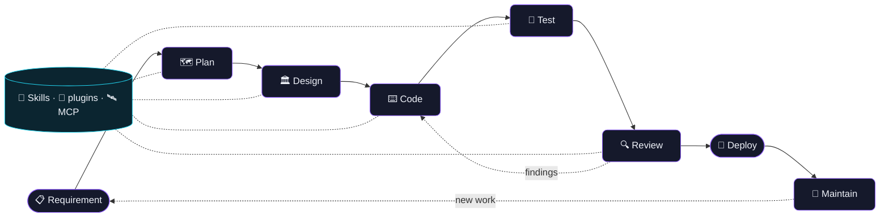

<picture>
  <source media="(prefers-color-scheme: dark)" srcset="assets/header-dark.svg">
  
</picture>

  
  
  
  
  

## 🛠️ What I build

<table>
  <tr>
    <td width="33%" valign="top">
      <h3>🏭 Software factories</h3>
      Teams of agents (product owner, architect, developer, QA, reviewer) take a requirement and ship a merged pull request end to end, 24×7 on a local cluster and AWS.
    </td>
    <td width="33%" valign="top">
      <h3>🔍 Code‑review bot</h3>
      AI review on every pull request across the organisation, with specialist lenses for bugs, security and design, and the same review as a CLI before you push.
    </td>
    <td width="33%" valign="top">
      <h3>🔁 Full pipeline automation</h3>
      Requirement, plan, design, code, tests, review, release and maintenance: agents do the steps, people approve them.
    </td>
  </tr>
  <tr>
    <td width="33%" valign="top">
      <h3>🧠 Claude skills</h3>
      Packaged know‑how that agents load when they need it: factory runbooks, review checklists, release steps.
    </td>
    <td width="33%" valign="top">
      <h3>🔌 Plugins</h3>
      Claude Code plugins with commands, hooks and sub‑agents that bring a team's whole workflow into the terminal.
    </td>
    <td width="33%" valign="top">
      <h3>🛰️ MCP servers</h3>
      Safe tools and data for agents: repositories, tickets, docs and code knowledge graphs, so they read only what matters.
    </td>
  </tr>
</table>

## 🧭 How I work

<table>
  <tr>
    <td width="25%" valign="top"><b>🤖 Agents do the work</b> Agents plan, code, test and review. I design the system they work in.</td>
    <td width="25%" valign="top"><b>👀 People decide</b> Every change gets an AI review and a person's yes before it ships.</td>
    <td width="25%" valign="top"><b>✅ Green CI or no merge</b> Tests run on every pull request, and open blocking findings stop the merge.</td>
    <td width="25%" valign="top"><b>🏠 Own cloud or local</b> AI runs in our own AWS account or on local models, so code and data stay with us.</td>
  </tr>
</table>

<b>How a change flows through the pipeline</b>

 

## 🧪 Projects

### ⭐ [Ihaaya Star Chart](https://ankitkatiyar567.github.io/ihaya/) · built at home

  
  
  
  

A picture star chart I built for my 5‑year‑old daughter. Every evening she rates her own day with ⭐ or ❌ on picture tasks (sleep, TV time, food, tidying up, kindness, how often she cried), a good day opens a 3‑minute mini game, and every night ends with a 7–10 minute bedtime story. Free, no sign‑up, works as a phone app and keeps the data on the phone.

**Why:** at this age kids get angry and stubborn, and scolding rarely works. Rating herself teaches her to be honest about her own day, the stars and the game turn good behaviour into small wins she can see, and the Friday report celebrates a good week or gently shows what to practise, never with punishment. A clear routine she looks forward to does the disciplining for us.

<table>
  <tr>
    <td width="50%" valign="top">
      <h3>📚 <a href="https://github.com/ankitkatiyar567/kids-story-buddy">Kids Story Buddy</a></h3>
      A voice‑driven choose‑your‑own‑adventure story app for kids, in English, Hindi and Finnish.
    </td>
    <td width="50%" valign="top">
      <h3>🌐 <a href="https://ankitkatiyar567.github.io">Portfolio</a></h3>
      My AI‑themed CV and portfolio: projects, writing and the way I work with agents.
    </td>
  </tr>
</table>

## 🧰 Stack

  

  
  
  
  
  
  
  

## 👤 About

- 🤖 Applied AI Engineer at **Vaisala**, automating the software pipeline end to end with multi‑agent systems
- 🏗️ **13+ years** of Java 17, Spring Boot and NestJS on AWS and Kubernetes, in renewable energy, smart metering and logistics
- ✍️ I write about practical, tool‑centric AI on [Medium @theRealSignet](https://medium.com/@theRealSignet)

## ✍️ Latest writing

- [AI's Next Phase Won't Be Bigger Models — It Will Be Smaller, Specialized, and Tool-Centric](https://medium.com/@theRealSignet)
- [Built a Free AI Code Review Tool for Bitbucket Server Using Just a Markdown File](https://medium.com/@theRealSignet)
- [I Stopped Using AI as a Tool. I Started Architecting With It.](https://medium.com/@theRealSignet)

Built with agents · reviewed by people

